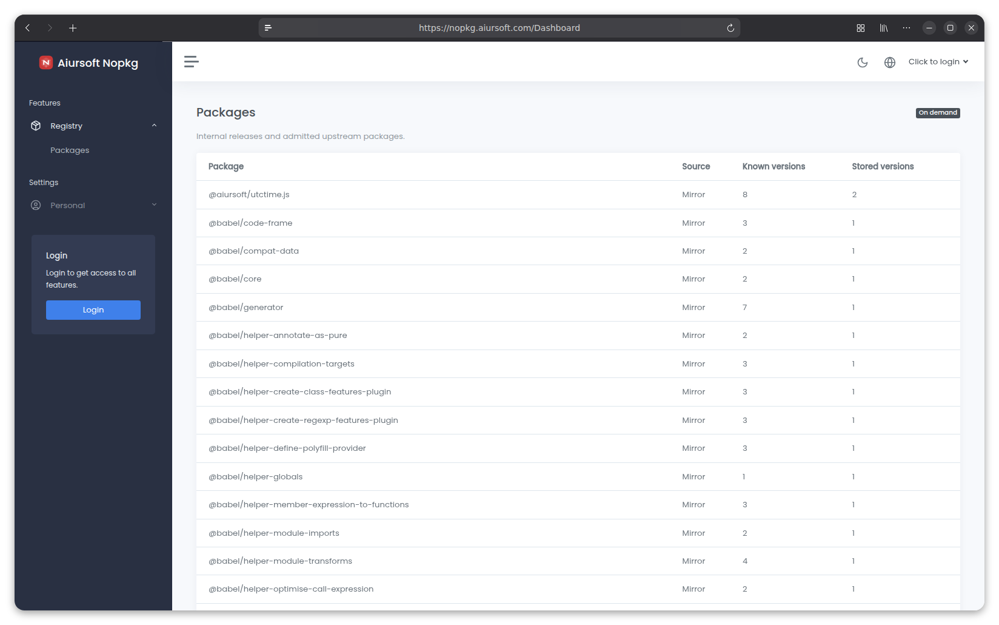

# Aiursoft Nopkg

<a name="nopkg"></a>

[](https://github.com/aiursoftweb/nopkg/blob/master/LICENSE)
[](https://gitlab.aiursoft.com/aiursoft/nopkg/-/pipelines)
[](https://gitlab.aiursoft.com/aiursoft/nopkg/-/pipelines)
[](https://s360.aiursoft.com/SupplyChain?tab=projects&project=aiursoft%2Fnopkg&scope=baseline&ecosystem=all)
[](https://manhours.aiursoft.com/r/github.com/aiursoftweb/nopkg.html)
[](https://nopkg.aiursoft.com)
[](https://hub.docker.com/r/aiursoft/nopkg)

Nopkg is an npm registry built on Aiursoft Template, and the npm sibling of [Nupkg](https://github.com/aiursoftweb/nupkg). Publish packages you own, cache upstream tarballs on demand, and optionally restrict mirrored packages to versions admitted by S360.



## Overview

### What is Nopkg?

<a name="what-is-nopkg"></a>

- Standard npm metadata, scoped packages, exact versions and dist-tags under `/npm/`.
- On-demand caching of original tarballs, with integrity and package identity checks.
- Optional S360 admission for metadata and every download, including cached archives.
- Personal API keys, package ownership, immutable publishing and distribution-tag management.
- Cache-only operation when the upstream is unavailable.
- Shared Aiursoft accounts, OIDC, roles, themes and localization.

See [publishing packages](./docs/publishing.md) for personal keys, ownership and publishing the same artifact to internal and public registries. The npm audit API is not implemented; requests return 501 rather than a clean security report.

## Try

Browse the running [Nopkg instance](https://nopkg.aiursoft.com).

## Install with Docker

Run the installer with the desired port (omit it to choose an available port):

```bash
curl -fsSL https://raw.githubusercontent.com/aiursoftweb/nopkg/master/install.sh | sudo bash -s -- 8080
```

Installation starts after three seconds; press Ctrl+C to cancel. Then open `http://localhost:8080`.

## Run manually

Requires [.NET 10 SDK](https://dotnet.microsoft.com/download/dotnet/10.0) and [Node.js](https://nodejs.org/).

```sh
dotnet run --project src/Aiursoft.Nopkg/Aiursoft.Nopkg.csproj -- --urls http://localhost:5000
```

The .NET build automatically runs `npm ci` and `npm run build` to prepare the frontend assets. Node.js and npm must be available when building from source.

Open `http://localhost:5000`. The default local administrator is `admin@default.com` with password `Admin@123456!`. Configure authentication before exposing a deployment.

## Run in Microsoft Visual Studio

Open `Aiursoft.Nopkg.sln` and press **F5**.

## Run in Docker

The shared CI builds Linux amd64 and arm64 images. Successful master pipelines publish `aiursoft/nopkg:latest` and `hub.aiursoft.com/aiursoft/nopkg:latest`.

```sh
docker run -d --name nopkg -p 8080:5000 -v nopkg-data:/data aiursoft/nopkg:latest
```

Persist `/data` for the default SQLite database, package cache and application files. The registry is `/npm/`; health checks use `/health`. Use the standard port-selecting installer:

```sh
curl -fsSL https://raw.githubusercontent.com/aiursoftweb/nopkg/master/install.sh | sudo bash -s -- 8080
```

## Usage

### Use the registry

Point npm at your own deployment:

```sh
npm config set registry https://nopkg.example.com/npm/
npm install your-package
```

For a public npm lockfile, use npm's `--replace-registry-host=always` option with your registry to download the locked versions through Nopkg without changing their integrity values.

## Configuration

The application defaults are defined in [`src/Aiursoft.Nopkg/appsettings.json`](src/Aiursoft.Nopkg/appsettings.json). The Docker image initializes `/data/appsettings.json` on its first start and keeps it for later starts; persist `/data`. Override nested values with double-underscore environment variables, such as `Logging__LogLevel__Default`.

```jsonc
{
  "Registry": {
    "Upstream": "https://registry.npmjs.org/",
    "StoragePath": "/tmp/data/npm",
    "CacheOnly": false,
    "MaxArchiveBytes": 536870912,
    // Enable only with a dedicated S360 check key. Failures then refuse all package access.
    "S360": {
      "Enabled": false,
      // Set to this registry URL to use one internal-source S360 policy. Empty keeps origin-based admission.
      "PolicySource": "",
      "Server": "",
      // Set Registry__S360__CheckKey through the deployment environment, never commit a key.
      "CheckKey": ""
    }
  },
  "ConnectionStrings": {
    // True: cache EF Core query results in this process. False: read from the database on every query.
    "AllowCache": "True",

    // Sqlite: use a local database file and no database server. MySql: use an external MySQL server.
    // When changing this value, also replace DefaultConnection with a connection string for that provider.
    "DbType": "Sqlite",
    // With Sqlite, this creates app.db in the process working directory and applies migrations at startup.
    "DefaultConnection": "DataSource=app.db;Cache=Shared"

    // MySql requires a reachable server, database, user, and password. The application applies migrations at startup.
    // sudo docker run -d --name db -e MYSQL_RANDOM_ROOT_PASSWORD=true -e MYSQL_DATABASE=nopkg -e MYSQL_USER=nopkg -e MYSQL_PASSWORD=nopkg_password -p 3306:3306 hub.aiursoft.com/mysql
    //"DbType": "MySql",
    //"DefaultConnection": "Server=localhost;Database=nopkg;Uid=nopkg;Pwd=nopkg_password;"
  },
  "Storage": {
    // Writable local directory for public Workspace files and token-protected private Vault files.
    // This is not an S3 or MinIO bucket.
    // The Docker image changes /tmp/data to /data; mount /data as a persistent volume in production.
    "Path": "/tmp/data",

    // Optional second hostname for this application's own /download endpoints; this is not an S3 or MinIO URL.
    // Example: set https://files.example.com, point that DNS name to this server, and add this Caddy route:
    // files.example.com {
    //     reverse_proxy 127.0.0.1:5000
    // }
    // Replace 127.0.0.1:5000 with the same upstream used by the web UI. Leave empty to use the UI hostname.
    "PublicOrigin": "",

    // False: verified images and configured media can open on the normal web hostname.
    // True: inline viewing works only through PublicOrigin; the same request on the UI hostname downloads the file.
    // True requires PublicOrigin plus DNS, TLS, and a reverse-proxy route to this same application instance.
    "RequireDedicatedInlineOrigin": false,

    // False: only verified images and SafeInlineMediaExtensions open in the browser; every other file downloads.
    // True: every file type may open through PublicOrigin, and HTML or SVG scripts may run there.
    // True requires RequireDedicatedInlineOrigin=true and a PublicOrigin that receives no application cookies.
    "AllowArbitraryInlineOnDedicatedOrigin": false,

    // File extensions allowed to open after content-signature validation. Empty means no extra audio, video, or SVG.
    // Supported values are mp3, mp4, ogg, svg, wav, and webm. This does not grant upload permission.
    "SafeInlineMediaExtensions": ["svg"],

    // SVG opens only when svg is enabled above and its Workspace path starts with an entry in this list.
    // Example: [ "markdown-images" ]. Empty means every SVG downloads.
    "SafeInlineSvgSubfolders": ["project-logo"],

    // These values are copied into newly issued signed upload tokens; existing tokens keep their old policy.
    "UploadPolicy": {
      // False: a valid signed upload token is enough. True: the uploader must also be signed in to this application.
      "RequireAuthenticatedUser": false,

      // False: preserve spaces in uploaded file names. True: save each space as a hyphen.
      "ReplaceSpacesWithHyphens": false
    }
  },
  "AppSettings": {
    // Local: use built-in accounts and passwords. OIDC: redirect sign-in to an external identity provider.
    // OIDC also requires the OIDC section below and a provider callback URL of https://<web-host>/signin-oidc.
    "AuthProvider": "Local",

    // Empty: assign no automatic role. Otherwise, assign this role to every new local or OIDC user.
    // With Local, create the role first. With OIDC, the application creates it during account synchronization.
    "DefaultRole": "",

    // False: sign-in ends when the browser session closes. True: issue a persistent sign-in cookie.
    "PersistsSignIn": false,

    // This section is used only when AuthProvider is OIDC.
    "OIDC": {
      // Provider discovery base URL. It must be reachable by the application and should use HTTPS in production.
      "Authority": "https://auth.aiursoft.com/application/o/nopkg",
      // Client identifier created for this application in the OIDC provider.
      "ClientId": "",
      // Client secret created by the provider. Set AppSettings__OIDC__ClientSecret instead of committing a real secret.
      "ClientSecret": "",

      // Claim containing role names. On every login, local roles are replaced by these roles plus DefaultRole.
      "RolePropertyName": "groups",
      // Required claim used as the local username when an OIDC account is first created.
      "UsernamePropertyName": "preferred_username",
      // Required claim copied to the local display name on every login.
      "UserDisplayNamePropertyName": "name",
      // Required unique email claim. The provider must keep it verified, unique, and stable.
      "EmailPropertyName": "email",
      // Required immutable account identifier. Keep this mapped to the standard OIDC sub claim.
      "UserIdentityPropertyName": "sub"
    },

    // This section is used only when AuthProvider is Local.
    "Local": {
      // True: show self-registration and allow new local accounts. False: existing users can sign in, but cannot register.
      "AllowRegister": true,
      // True: require only six characters. False: require eight characters with upper, lower, digit, and symbol.
      "AllowWeakPassword": true
    }
  },
  "GlobalSettings": {
    // Leave an entry commented to use the database value or built-in default.
    // Uncommenting an entry forces that value and overrides changes made in the administration UI.

    // True: users may change their display nickname. False: only administrators control it.
    // "Allow_User_Adjust_Nickname": "True",
    // Text shown as the brand name in the footer.
    // "BrandName": "Aiursoft",
    // URL opened when a user clicks the footer brand name.
    // "BrandHomeUrl": "https://www.aiursoft.com/",
    // Mainland China ICP license number. Empty hides it.
    // "Icp": "",
    // Application name shown in the web interface.
    // "ProjectName": "Aiursoft Nopkg"
  },
  "Logging": {
    "LogLevel": {
      // Minimum level for application logs. Typical values: Debug, Information, Warning, Error, or None.
      "Default": "Information",
      // Separate minimum level for ASP.NET Core framework logs; Warning reduces routine request noise.
      "Microsoft.AspNetCore": "Warning"
    },
    "Clickhouse": {
      // False: do not send logs to ClickHouse. True: create TableName at startup and send logs in batches.
      // Before enabling, provide a reachable ClickHouse server and valid credentials in ConnectionString.
      "Enabled": false,
      // ClickHouse host, protocol, port, credentials, and database. Used only when Enabled is true.
      "ConnectionString": "Host=localhost;Protocol=http;Port=8123;User=default;Password=;Database=AspNetCoreLogs",
      // ClickHouse table created and used for application logs when Enabled is true.
      "TableName": "NopkgLogs"
    }
  },
  // ASP.NET Core Host-header allowlist; this is not a CORS setting.
  // * accepts every hostname. In production, use semicolon-separated names such as example.com;www.example.com.
  "AllowedHosts": "*"
}
```

Set `Registry:Upstream` and `Registry:StoragePath` for the source and persistent cache. Set `Registry:CacheOnly=true` to prevent upstream requests. Use one application instance per cache directory.

S360 admission is disabled in the development default. To enable it, configure `Registry:S360:Enabled`, `Registry:S360:Server` and a dedicated `Registry__S360__CheckKey` environment secret. See [registry configuration](docs/registry.md) for admission, offline use and protocol limits. Shared account, database and theme settings follow [Aiursoft Template](https://template-docs.aiursoft.com/).

### Shared settings

- `ConnectionStrings` selects the database provider and connection. Prepare the external database before choosing MySQL; keep the SQLite file persistent when using SQLite.
- `Storage` configures local application files. Keep the storage directory persistent and use the documented hostname and upload policies for shared downloads.
- `AppSettings` controls authentication and account synchronization. Choose local accounts or configure the OIDC authority, client and `/signin-oidc` callback; use environment variables for credentials.
- Uncommented `GlobalSettings` entries override the database-backed administration settings. Leave entries commented to use the stored values or application defaults.
- `Logging:LogLevel` controls application and framework verbosity. Configure the optional ClickHouse exporter only when its server and credentials are ready.
- `AllowedHosts` is the ASP.NET Core Host-header allowlist, not a CORS setting.

## How to contribute

<a name="contributing"></a>

Use the existing build, tests and `lint.sh`. NugetNinja maintains the shared Template files and dependency conventions through `ninja.yaml`. Normal `nuget.config` uses public NuGet for external contributors; company CI uses the separate internal build configuration.

## License

<a name="credits"></a>

Built on [Aiursoft Template](https://github.com/aiursoftweb/template). Licensed under the [MIT License](./LICENSE).
