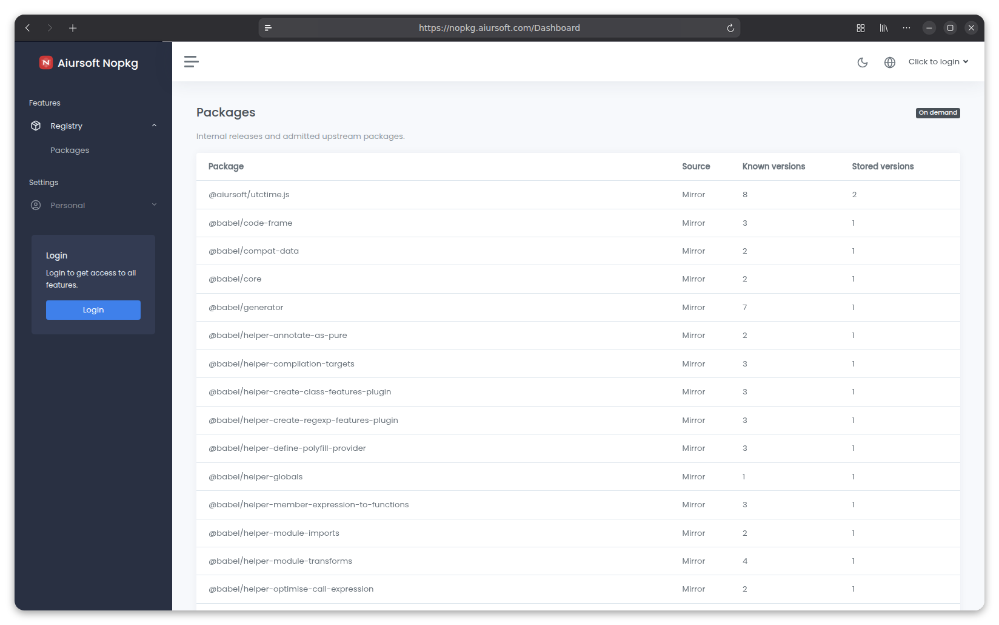

# Nopkg

[](./LICENSE)
[](https://gitlab.aiursoft.com/aiursoft/nopkg/-/pipelines)
[](https://gitlab.aiursoft.com/aiursoft/nopkg/-/pipelines)
[](https://s360.aiursoft.com/SupplyChain?tab=projects&project=aiursoft%2Fnopkg&scope=baseline&ecosystem=all)
[](https://hub.docker.com/r/aiursoft/nopkg)

Nopkg is an npm registry built on Aiursoft Template, and the npm sibling of [Nupkg](https://gitlab.aiursoft.com/aiursoft/nupkg). Publish packages you own, cache upstream tarballs on demand, and optionally restrict mirrored packages to versions admitted by S360.



## What is Nopkg?

- Standard npm metadata, scoped packages, exact versions and dist-tags under `/npm/`.
- On-demand caching of original tarballs, with integrity and package identity checks.
- Optional S360 admission for metadata and every download, including cached archives.
- Personal API keys, package ownership, immutable publishing and distribution-tag management.
- Cache-only operation when the upstream is unavailable.
- Shared Aiursoft accounts, OIDC, roles, themes and localization.

See [publishing packages](./docs/publishing.md) for personal keys, ownership and publishing the same artifact to internal and public registries. The npm audit API is not implemented; requests return 501 rather than a clean security report.

## Use the registry

Point npm at your own deployment:

```sh
npm config set registry https://nopkg.example.com/npm/
npm install your-package
```

For an existing lockfile, configure its resolved archive URLs for your deployment as well. Changing the registry setting alone does not rewrite existing lockfile URLs.

## Run manually

Requires [.NET 10 SDK](https://dotnet.microsoft.com/download/dotnet/10.0) and [Node.js](https://nodejs.org/).

```sh
cd src/Aiursoft.Nopkg/wwwroot
npm ci
npm run build
cd ..
dotnet run
```

Open `http://localhost:5000`. The default local administrator is `admin@default.com` with password `Admin@123456!`. Configure authentication before exposing a deployment.

## Run in Microsoft Visual Studio

Open `Aiursoft.Nopkg.sln` and press **F5**.

## Run in Docker

The shared CI builds Linux amd64 and arm64 images. Successful master pipelines publish `aiursoft/nopkg:latest` and `hub.aiursoft.com/aiursoft/nopkg:latest`.

After the first master release:

```sh
docker run -d --name nopkg -p 8080:5000 -v nopkg-data:/data aiursoft/nopkg:latest
```

Persist `/data` for the default SQLite database, package cache and application files. The registry is `/npm/`; health checks use `/health`. The repository's `install.sh` provides the standard port-selecting installer.

## Configuration

Set `Registry:Upstream` and `Registry:StoragePath` for the source and persistent cache. Set `Registry:CacheOnly=true` to prevent upstream requests. Use one application instance per cache directory.

S360 admission is disabled in the development default. To enable it, configure `Registry:S360:Enabled`, `Registry:S360:Server` and a dedicated `Registry__S360__CheckKey` environment secret. See [registry configuration](docs/registry.md) for admission, offline use and protocol limits. Shared account, database and theme settings follow [Aiursoft Template](https://template-docs.aiursoft.com/).

## Contributing

Use the existing build, tests and `lint.sh`. NugetNinja maintains the shared Template files and dependency conventions through `ninja.yaml`. Normal `nuget.config` uses public NuGet for external contributors; company CI uses the separate internal build configuration.

## Credits

Built on [Aiursoft Template](https://gitlab.aiursoft.com/aiursoft/template). Licensed under the [MIT License](./LICENSE).
